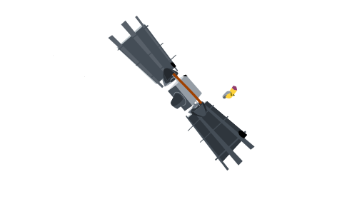

# Hi there, I am Arturo Cabrera 👋

  

- 🔭 I'm currently working as CEO at **[AC Tecnology](https://actecnology.com/)** and **[ArturoCabrera.com](https://arturocabrera.com/)**
- 🌱 I'm currently learning 
- 💻 Working with  **Magento 2**
- 🌎 Living in **Quito, Ecuador**
- 🎮 I like to watch movies and tech content
- 📫 Reach me: **arturo.cabrera.dev@gmail.com**

---

### 🛠 Technologies & Stack:

  
  
  
  
  
  
  
  
  
  
  
  
  
  
  
  

### ⭐ Support my work 
- 🐍 [Python Scripts Repo](https://github.com/GNUXDAR/scripts_py)
- 🎨 [Frontend Design Repo](https://github.com/GNUXDAR/frontend-design)

### 🏆 Certificates
Coming soon — certificates will appear here when available.

<!-- Ejemplos de certificados (copiados/añadidos al estilo de sanjay-kv) -->
<!--

<a href="https://www.udemy.com">

-->

### 📹 Featured Videos on [gnuxdar News](https://youtube.com/gnuxdar?sub_confirmation=1)

  
  
  
  
  
  
  
  

### 📱 Social Media

  <!-- Bottom logo removed as requested -->

